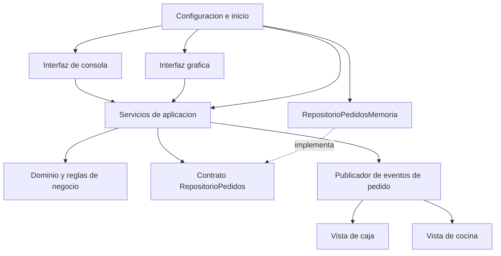
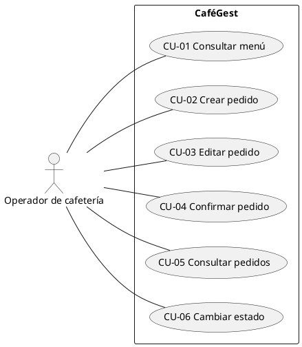
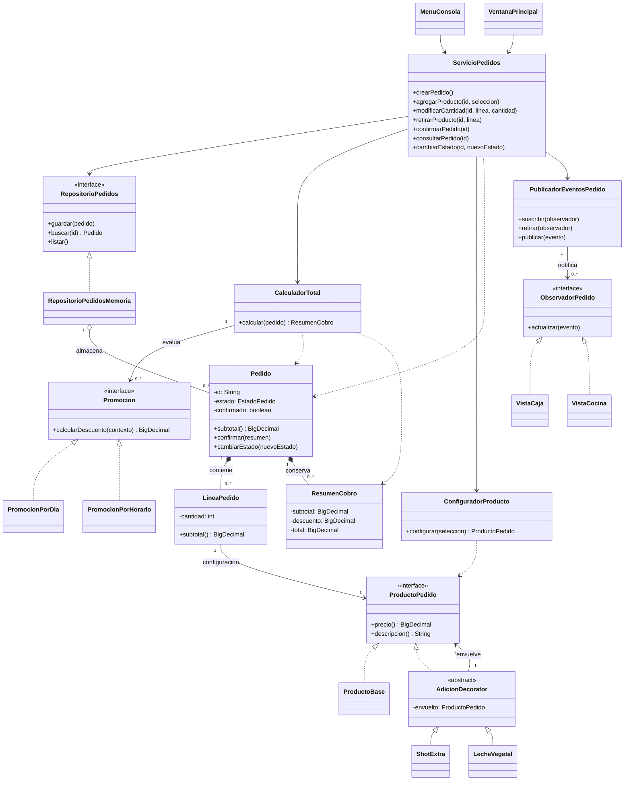

# Arquitectura y modelo inicial de CaféGest

Modelo objetivo del sistema. Ya existen el punto de entrada `AplicacionCafeGest`, la consola inicial `MenuConsola` y sus pruebas; los servicios, entidades, patrones e interfaz gráfica descritos aquí todavía no están implementados. Este modelo desarrolla las decisiones de [diseño](diseno.md) y los [requisitos](requisitos.md). Los diagramas deberán actualizarse a medida que se implementen las clases.

## Separación de responsabilidades

La consola y la interfaz gráfica usarán las mismas instancias de servicios y el mismo almacenamiento en memoria dentro de una ejecución. Las interfaces recogen entradas y presentan resultados; los servicios validan operaciones y coordinan el dominio. El dominio no conoce ventanas, menús de consola ni componentes gráficos.

Las flechas continuas de las interfaces hacia los servicios representan llamadas. Las flechas del publicador hacia las vistas representan notificaciones mediante el contrato `ObservadorPedido`, no dependencias hacia clases gráficas concretas. Las vistas de caja y cocina pertenecen a la presentación. La consola puede usar observadores que impriman avisos; la interfaz gráfica puede usar otros que actualicen componentes.

## Paquetes previstos

| Paquete base `cafegest` | Responsabilidad y clases principales |
| --- | --- |
| `dominio.catalogo` | `ProductoMenu`, `CatalogoMenu`, `ReglasAdiciones`: precios, disponibilidad y compatibilidad. |
| `dominio.producto` | `ProductoPedido`, `ProductoBase`, `AdicionDecorator`, `ShotExtra`, `LecheVegetal`: configuración personalizada de una unidad. |
| `dominio.pedido` | `Pedido`, `LineaPedido`, `EstadoPedido`, `ResumenCobro`: líneas, cantidades, estado e importes confirmados. |
| `dominio.promocion` | `Promocion`, `ContextoPromocion`, `PromocionPorDia`, `PromocionPorHorario`: estrategias de descuento. |
| `aplicacion` | `ServicioPedidos`, `CalculadorTotal`, `ConfiguradorProducto`: casos de uso y coordinación. |
| `aplicacion.puerto` | `RepositorioPedidos`, `ObservadorPedido`: contratos independientes de almacenamiento e interfaz. |
| `aplicacion.evento` | `PedidoCambioEstado`, `PublicadorEventosPedido`: avisos locales del pedido. |
| `infraestructura.memoria` | `RepositorioPedidosMemoria`: almacenamiento por identificador durante la sesión. |
| `interfaz.consola` | `MenuConsola`, `AvisosConsola`: entrada, salida y avisos de texto. |
| `interfaz.grafica` | `VentanaPrincipal`, `VistaCaja`, `VistaCocina`: entrada y presentación gráfica. |
| `configuracion` | `AplicacionCafeGest`: construcción e inyección de servicios, reloj, repositorio, estrategias y observadores. |

No habrá dependencias del dominio hacia `interfaz` o `infraestructura`. `RepositorioPedidosMemoria` implementará el puerto y no contendrá reglas sobre descuentos o estados. Se usa Java 21; la biblioteca gráfica todavía no está elegida.

## Responsabilidades y reglas del modelo

- **ProductoMenu:** dato del catálogo con identificador, categoría, precio base y disponibilidad. Cambiar el catálogo no alterará retroactivamente los importes de un pedido confirmado.
- **ConfiguradorProducto:** comprueba disponibilidad y compatibilidad y crea `ProductoBase` con sus decoradores. La validación sucede antes de cambiar la línea del pedido; una configuración inválida no deja cambios parciales.
- **ProductoPedido:** contrato para consultar precio unitario y descripción. `ProductoBase` conserva los datos necesarios de la selección; un decorador guarda un componente del mismo contrato y añade una responsabilidad.
- **LineaPedido:** guarda un `ProductoPedido` y una cantidad entera positiva. Calcula su subtotal como precio unitario por cantidad. Modificarla requiere pasar por el agregado `Pedido`.
- **Pedido:** protege sus líneas y su estado. Solo permite editar mientras esté recibido y todavía no confirmado. `confirmar` rechaza un pedido vacío y fija un `ResumenCobro` inmutable. Un pedido confirmado permanece recibido hasta comenzar la preparación, pero ya no puede editarse: es una restricción adicional dentro del estado recibido, que satisface RF-04.
- **ResumenCobro:** conserva subtotal, descuento y total definitivos, usando `BigDecimal`. La consulta posterior no recalcula promociones según la hora actual.
- **CalculadorTotal:** crea el contexto con un instante de confirmación obtenido de un `Clock` inyectado, calcula las estrategias registradas, elige el mayor descuento sin acumular y limita el total para que no sea negativo. Usa dos decimales y `HALF_UP`.
- **ServicioPedidos:** ofrece crear, agregar, modificar, retirar, confirmar, consultar y cambiar estado. Obtiene y guarda el agregado mediante `RepositorioPedidos`, devuelve datos para presentación y no expone colecciones mutables del dominio.
- **EstadoPedido:** enumeración `RECIBIDO`, `EN_PREPARACION`, `ENTREGADO`. Se necesita confirmación antes de iniciar preparación. Solo se permite avanzar al siguiente estado; confirmar no es un cuarto estado.
- **PublicadorEventosPedido:** notifica a los observadores después de guardar una transición válida. Un rechazo no genera eventos. Los errores de un receptor se reportan y no evitan avisar a los demás. No se añaden correo, SMS ni sincronización entre equipos.

## Casos de uso

**Actor humano principal:** operador de la cafetería. Caja y cocina son funciones del personal, no roles de seguridad: esta versión no incorpora cuentas ni permisos. Los clientes del local no operan directamente la aplicación. Las vistas y los servicios internos no son actores externos.

| Caso | Acción y resultado observable | Requisitos |
| --- | --- | --- |
| CU-01 Consultar menú | Ver productos con categoría, precio y disponibilidad. | RF-01 |
| CU-02 Crear pedido | Obtener identificador único de sesión y estado recibido. | RF-02 |
| CU-03 Editar pedido | Agregar, retirar, cambiar cantidades y elegir adiciones compatibles antes de confirmar. Entradas inválidas conservan el pedido anterior. | RF-03, RF-04, RF-05 |
| CU-04 Confirmar pedido | Validar que no esté vacío, fijar precios, aplicar la mejor promoción vigente y mostrar el resumen. | RF-06, RF-07, RF-08, RF-12 |
| CU-05 Consultar pedidos | Ver lista y detalle de líneas, cantidades, valores y estado. | RF-11 |
| CU-06 Cambiar estado | Avanzar un pedido confirmado; avisar a caja y cocina tras una transición válida. | RF-09, RF-10 |

### Diagrama de casos de uso en PlantUML

Fuente UML editable. GitHub muestra este bloque como texto; se puede renderizar con PlantUML. Las operaciones internas de sumar importes o guardar datos no se modelan como objetivos separados del actor.

### Flujo principal de confirmación

**Precondición:** existe un pedido recibido y no confirmado.

1. El operador solicita confirmar el pedido desde consola o interfaz gráfica.
2. `ServicioPedidos` obtiene el pedido y comprueba que tenga líneas y una configuración válida.
3. `CalculadorTotal` calcula el subtotal y evalúa las promociones con una sola fecha/hora de confirmación.
4. El servicio entrega el resumen al pedido, que lo conserva y bloquea futuras ediciones.
5. Se guarda el pedido y se presenta subtotal, descuento y total. El estado continúa recibido.

**Alternativas:** un pedido vacío se rechaza sin cambios; no hay promociones vigentes y el descuento es cero; hay varias y se elige solo el mayor descuento; un pedido ya confirmado se rechaza sin recalcular sus importes. El cambio a preparación se realiza después mediante CU-06.

## Primer diagrama de clases general

El diagrama presenta contratos, relaciones y operaciones clave. Los tipos auxiliares `ContextoPromocion`, `EstadoPedido` y `PedidoCambioEstado` se describen en el texto para mantener legible esta primera vista. Las multiplicidades reflejan una configuración por línea, varias líneas por pedido y varios observadores por publicador.

**Roles de patrones:** `ProductoPedido` es el componente; `ProductoBase`, el componente concreto; `AdicionDecorator`, el decorador base; `ShotExtra` y `LecheVegetal`, decoradores concretos. `Promocion` es la estrategia y `CalculadorTotal` su contexto. `PublicadorEventosPedido` es el sujeto y `ObservadorPedido` el contrato de los observadores.

## Límites y revisión posterior

Las mutaciones pasarán por `ServicioPedidos` y las reglas protegidas por `Pedido`. Una clase gráfica no calculará descuentos ni forzará estados. El código deberá mantener el catálogo y las configuraciones confirmadas consistentes. Los detalles de visibilidad, constructores y transferencias de datos se concretarán al implementar; este primer diagrama no reemplaza los diagramas por patrón ni el diagrama de secuencia final.

Las pruebas actuales cubren únicamente el ciclo de vida de la consola inicial. Las reglas y relaciones del modelo objetivo deberán comprobarse al implementar los servicios y el dominio.
