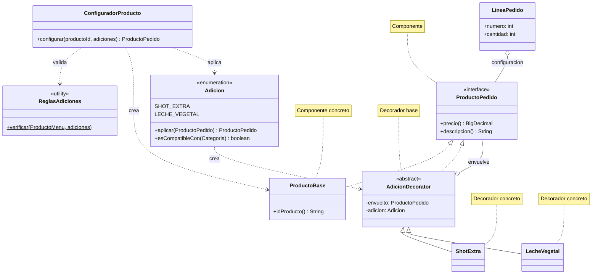
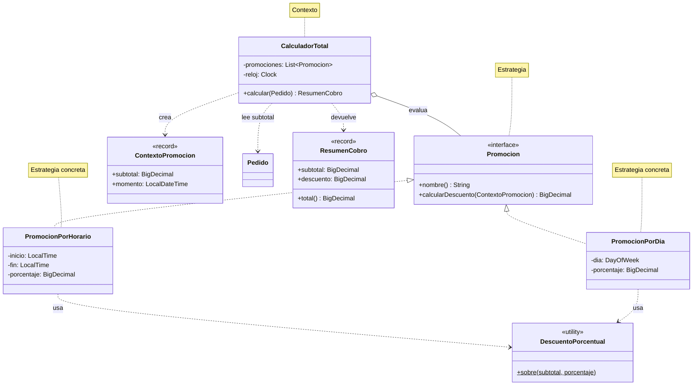
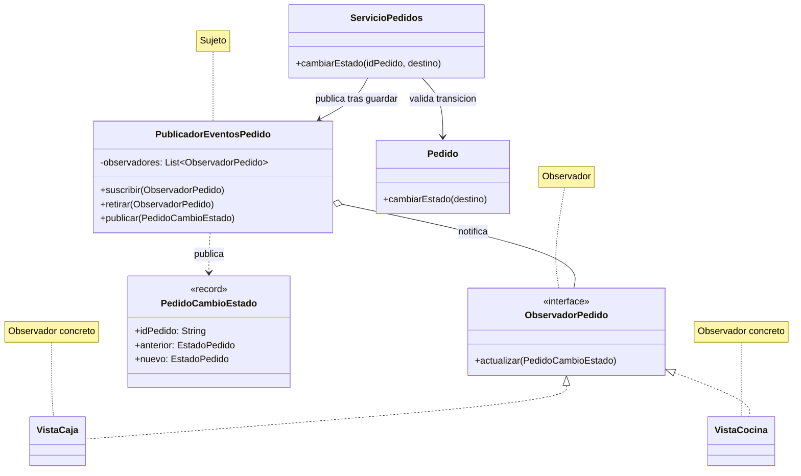
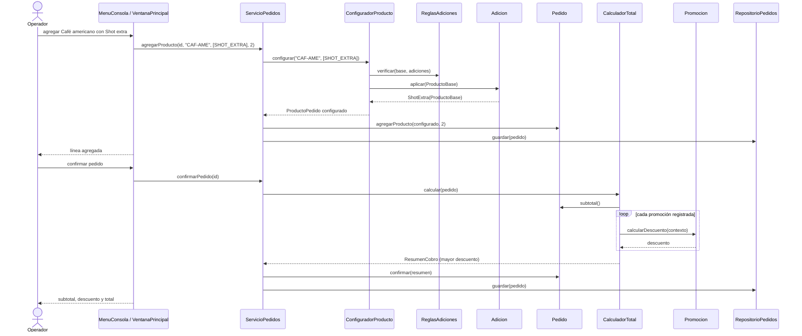
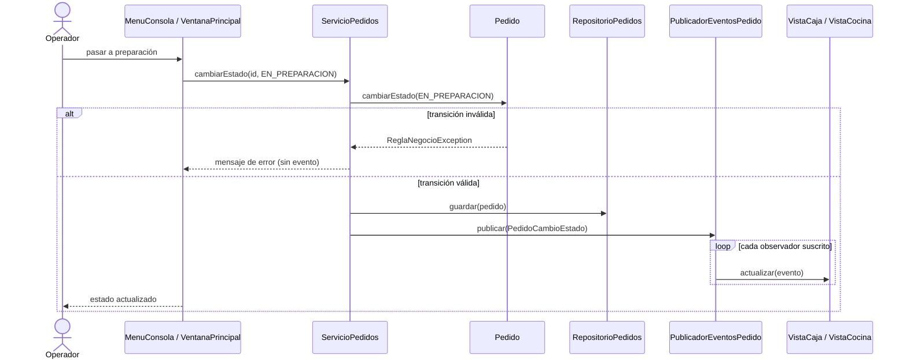

# Diagramas de CaféGest

Los diagramas siguen el código actual del repositorio. Las clases mostradas existen con esos nombres en los paquetes indicados. Los diagramas de Mermaid se renderizan en GitHub. El diagrama de casos de uso está como código PlantUML en [casos-de-uso.puml](casos-de-uso.puml); para verlo, péguelo en [el editor de PlantUML](https://www.plantuml.com/plantuml) o ejecute `java -jar plantuml.jar -tpng docs/casos-de-uso.puml`.

## Diagrama de clases del patrón Decorator

Personalización de un producto con adiciones (`cafegest.dominio.producto` y `cafegest.aplicacion`).

## Diagrama de clases del patrón Strategy

Descuentos intercambiables sobre el subtotal (`cafegest.dominio.promocion` y `cafegest.aplicacion`).

## Diagrama de clases del patrón Observer

Avisos de cambio de estado a caja y cocina (`cafegest.aplicacion.evento`, `cafegest.aplicacion.puerto` e `cafegest.interfaz.consola`).

## Diagrama de secuencia: agregar y confirmar un pedido

Flujo principal en el que participan Decorator (configurar el producto) y Strategy (calcular el descuento al confirmar).

## Diagrama de secuencia: cambio de estado y avisos

Flujo en el que participa Observer.

